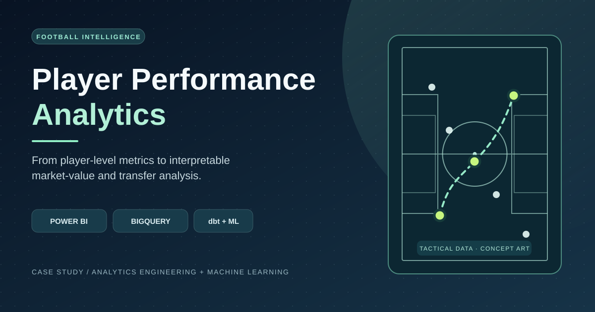
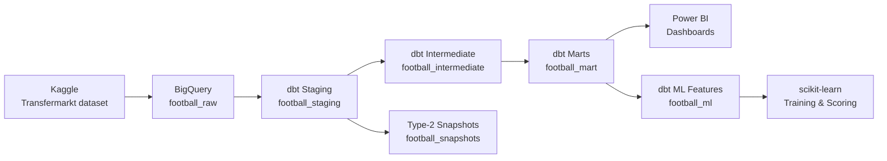

<p align="center">
  
  
  
  
  
  
</p>

<h1 align="center">Football Player Performance Analysis</h1>


**Reviewer quick brief:** [Project evidence, model baselines and contribution attribution](docs/hiring-summary.md).


> **Editorial cover, not a Power BI screenshot.** The six historical captures are archived, not verified output from the current NEXUS PBIR. See the [dashboard source overview](#dashboard-preview) and [Desktop verification gate](docs/POWER_BI_VISUAL_QA.md).


<p align="center">
  An end-to-end football analytics project, from Transfermarkt data and governed dbt marts to leakage-aware market-value modeling and interactive Power BI dashboards.
</p>

<p align="center">
  <a href="#architecture">Architecture</a> •
  <a href="#dashboard-preview">Dashboard</a> •
  <a href="#ml-model">ML Model</a> •
  <a href="#quick-start">Quick Start</a> •
  <a href="#documentation">Documentation</a>
</p>

---

**Kaggle notebook:** [Your Market-Value R2 Is Mostly Last Year's Price](https://www.kaggle.com/code/senanuretin/your-market-value-r2-is-mostly-last-year-s-price) — on the same Transfermarkt data, "next value = current value" already reaches R² 0.967; a time-split model reaches 0.972 on the value and 0.22 on the *change*, which is the honest measure of skill (compare the baseline column in the ML table below).

**Model on Hugging Face:** [senanurcetin/transfermarkt-value-change-lgbm](https://huggingface.co/senanurcetin/transfermarkt-value-change-lgbm) — the notebook's LightGBM, trained before July 2023 and tested on later predictions, with the persistence baseline in the model card.

**Attribution:** this repository is a fork of an earlier collaborative project. 28 of the 46 dbt models, plus the source definitions and their tests, come from upstream; the other 16 models, the singular tests, the semantic layer, snapshots, CI, the market-value ML pipeline and the Power BI report were added in this fork.

## Project Status

Validated against BigQuery — June 15, 2026

| Check | Result |
|---|---:|
| dbt models | **46** |
| Full CI validation resources | **292** |
| Source and data tests | **241 / 241 passed** |
| Source freshness | **12 / 12 sources passed** |
| Mart models (partitioned tables) | **25** |
| ML feature models + tests | **2 models / 43 tests** |
| Snapshots / analyses / exposures | **2 / 5 / 3** |
| Semantic models / governed metrics | **2 / 7** |
| Model documentation | **46 / 46** |
| Column documentation | **878 / 878** |
| Test warnings and errors | **0** |
| Non-null fact-to-dimension orphan keys | **0** |

---

## Architecture



| Layer | Materialization | Models | Purpose |
|---|---|---:|---|
| Raw | BigQuery source tables | 12 | Original imported dataset |
| Staging | Views | 12 | Cleaning, normalization, stable column naming |
| Intermediate | Views | 7 | Reusable business calculations and aggregations |
| Marts | Partitioned tables | 25 | Analytics-ready dimensions, facts, cohorts, labels |
| ML | Tables | 2 | Leakage-safe training and current-scoring features |

Full lineage, grains, and model responsibilities → [Architecture & Model Catalog](docs/ARCHITECTURE.md)

---

## Dashboard Preview

**Current release status: Power BI Desktop render verification pending.** The repository contains two PBIP editions: the BigQuery-backed [production report](powerbi/workspace/FootballPlayerAnalysis/) and a separately labeled [offline synthetic demo](powerbi/offline-demo/). Both report definitions have been updated to NEXUS navy-and-blue; a local Desktop open/refresh and page-by-page screenshot review is still required.

The six files in [historical screenshots](docs/assets/screenshots/) depict a **legacy green-themed version**. They are retained only as an archive and are **not screenshots of the current PBIR**, nor evidence that current metrics or visuals render correctly. They are deliberately not shown as current portfolio previews.

**Current report contents (source-verified):** Home; Player Performance; Player Segmentation (position, age groups, goals and value); Club & League (win rate, goal difference, competition activity); Transfer Success Analysis (observed 365-day outcomes, fee, coverage and reliability); Transfer & Market Value; Player Market Value Prediction; ML Model Reliability; Closing; two hidden detail pages; and two tooltip pages.

The transfer-success visualizations use observed transfer outcomes, **not machine-learning predictions**. Their label source is the 365-day BigQuery mart with a 20-percentage-point value-growth threshold. Demo fixtures are synthetic; no sample result can be cited as a real football outcome.

See [Power BI visual QA and release gate](docs/POWER_BI_VISUAL_QA.md) for the remaining Desktop acceptance tests. Publish new screenshots only after the actual Power BI Desktop report is open, refreshed and inspected.

---

## ML Model

### Overview

A production `HistGradientBoostingRegressor` pipeline that predicts current player market value using leakage-safe, season-lagged features. The model is retrained weekly and routes predictions through a quality-based ensemble.

### Performance (v5 ensemble — approved_with_monitoring)

| Metric | Ensemble | Baseline (prev. value) |
|---|---:|---:|
| MAE | **€781,409** | €867,156 |
| RMSE | **€2,039,156** | €2,248,309 |
| R² | **0.9756** | 0.9704 |
| WAPE | **12.51%** | 13.88% |

### Quality-Segment Routing

| Segment | Players | Method | Rationale |
|---|---:|---|---|
| High | 4,393 | 80% model + 20% baseline | Rich data — model is reliable |
| Medium | 1,967 | 100% model | Sufficient data — full model |
| Limited | 5,215 | 100% baseline | Sparse data — honest fallback |

### Feature Groups

- **Age** — strongest single predictor; value peaks at ages 24–27
- **Position & sub-position** — Forward/10 carries statistically significant premium
- **Performance** — minutes played, goals/90, assists/90, competition level
- **Valuation history** — previous highest value, valuation count, days since last valuation

Training set: **90,704** player-season rows. Leakage protection enforced by `assert_ml_features_precede_target`.

Full methodology, commands, interpretation, and limitations → [Player Market Value ML](docs/PLAYER_MARKET_VALUE_ML.md)

---

## Analytics Marts

<details>
<summary><strong>Dimensions (6 models)</strong></summary>

| Model | Grain | Purpose |
|---|---|---|
| `dim_players` | One row per player | Current and historical player dimension |
| `dim_clubs` | One row per club | Current and historical club dimension |
| `dim_competitions` | One row per competition | Competition reference dimension |
| `dim_national_teams` | One row per national team | National-team reference dimension |
| `dim_date` | One row per calendar date | Continuous date dimension for time intelligence |
| `time_spine_daily` | One row per calendar date | Governed Semantic Layer time spine |

</details>

<details>
<summary><strong>Facts (19 models)</strong></summary>

| Model | Grain | Purpose |
|---|---|---|
| `fct_player_performance` | One row per player | All-time player performance |
| `fct_player_career_timeline` | Player, season, competition | Seasonal performance and market value |
| `fct_club_performance` | One row per club | All-time club results |
| `fct_competition_performance` | One row per competition | Competition-level match metrics |
| `fct_market_value_history` | Player and valuation date | Player market value history |
| `fct_transfers` | One row per transfer | Transfer fees and fee-to-value comparisons |
| `fct_transfer_market_value_analysis` | One row per transfer | Detailed fee, nearest valuation, post-transfer value |
| `fct_transfer_fixed_horizon_outcomes` | One historical transfer | 90/180/365-day comparable outcomes |
| `fct_transfer_cohort_performance` | Cohort and horizon | Cohort statistics with confidence intervals |
| `fct_transfer_success_labels` | One 365-day transfer | Binary success label for ML |
| `fct_club_risk_profile` | One destination club | Transfer success, coverage, and risk profile |
| `fct_club_season_performance` | Club, season, competition | Seasonal club performance |
| `fct_club_transfer_portfolio` | Club and transfer season | Spend, income, premium, outcome portfolio |
| `fct_match` | One match | Match result and context |
| `fct_player_match_performance` | One appearance | Player-match performance and result |
| `fct_player_rolling_form` | One appearance | Trailing-5-appearance form |
| `fct_agent_portfolio` | One agent | Current represented-player portfolio |
| `fct_analytics_refresh_audit` | One dbt invocation | Append-only volume and coverage audit |
| `fct_data_coverage_bias` | Coverage segment | Missingness and selection-bias risk |

</details>

---

## Quick Start

### Prerequisites

- Python 3.10+
- `dbt-bigquery` 1.11.1
- Google Cloud project with BigQuery access
- Raw Transfermarkt dataset loaded into `football_raw` BigQuery dataset

### 1. Install dependencies

```bash
pip install -r requirements.txt
```

### 2. Configure your dbt profile

Copy the example profile and fill in your credentials (never commit service account files):

```bash
cp profiles.yml.example ~/.dbt/profiles.yml
```

```yaml
default:
  target: dev
  outputs:
    dev:
      type: bigquery
      method: service-account
      project: YOUR_GCP_PROJECT_ID
      dataset: football
      keyfile: /absolute/path/to/service-account.json
      threads: 4
      location: EU
```

Environment variable overrides: `DBT_PROJECT_ID`, `DBT_KEYFILE`, `DBT_DATASET`, `DBT_SOURCE_DATABASE`.

### 3. Build and validate

```bash
dbt debug
dbt source freshness --selector raw_sources
dbt build
dbt docs generate && dbt docs serve
```

### 4. Scoped builds

```bash
dbt build --select path:models/staging
dbt build --select path:models/marts
dbt build --select tag:ml
dbt test
```

### 5. Run the ML pipeline

```bash
pip install -r requirements-ml.txt
python scripts/train_player_market_value.py
python scripts/verify_ml_artifact.py
python scripts/verify_published_ml_outputs.py
```

Full deployment and troubleshooting → [Operations Runbook](docs/RUNBOOK.md)

---

## Power BI Dashboard

The report is stored in PBIP/PBIR format at `powerbi/workspace/FootballPlayerAnalysis/`; a credential-free, fictional-data copy is at `powerbi/offline-demo/FootballPlayerAnalysis/`. Start by opening the offline `FootballPlayerAnalysis.pbip` in a compatible Power BI Desktop installation and refreshing. Source-level validation alone cannot certify rendering.

### Report Pages

| Page | Current scope |
|---|---|
| Home | Navigation and report introduction |
| Player Performance Analysis | Per-90 rate tables, ranking and position comparisons |
| Player Segmentation | Position, age, goal and market-value breakdowns |
| Club & League Analysis | Club win rate and goal difference; competition activity |
| Transfer Success Analysis (365d) | Observed 365-day outcomes, 20% threshold, sample size and follow-up coverage |
| Transfer & Market Value Analysis | Fees, volume and premium/discount measures |
| Player Market Value Prediction | ML scoring and quality indicators (not authenticated yet) |
| ML Model Reliability | Model quality gates, feature diagnostics and evaluation tables |
| Closing | End page |

Two hidden detail pages and two tooltip pages are also in the PBIR page order.

**Verification status:** Definition files have been edited; real Desktop opening, data refresh, visuals, interactions and production BigQuery values are **not yet verified**. Do not use historical screenshot KPI numbers as proof of current results.


---

## Automation

Three GitHub Actions workflows cover the full lifecycle:

| Workflow | Trigger | Purpose |
|---|---|---|
| `dbt-ci.yml` | Push / PR / daily | Source freshness, full build, docs deploy, smoke test |
| `ml-production.yml` | Weekly / manual | Feature build → train → validate → score → publish |
| `docs-deploy.yml` | Push to `main` | Generate and deploy dbt docs to GitHub Pages |

The workflow uses `GCP_SERVICE_ACCOUNT_JSON` repository secret. Pull requests get isolated temporary BigQuery datasets that are deleted after the run.

---

## Data Quality Strategy

- Source `not_null`, `unique`, and freshness checks (7-day warning / 14-day error SLA)
- Model grain and referential integrity checks
- Layer-to-layer row coverage and value reconciliation
- Business-rule checks (age, sentinel normalization, market value sequencing)
- Fixed-horizon transfer outcome checks
- Cohort reliability and coverage-bias diagnostics
- Volume anomaly detection via append-only audit fact
- 4 ML assertions: leakage, coverage, business rules, scoring readiness
- Complete model and column documentation enforcement in CI

Full test results and known source limitations → [Data Quality](docs/DATA_QUALITY.md)

---

## Key Transformation Rules

- Sentinel identifiers (`-1`) normalized to `NULL`
- Transfer monetary fields use BigQuery `NUMERIC`
- Player age calculated as completed years with birthday-aware logic
- Transfer analysis uses transfer-record market value when available, otherwise latest prior valuation
- Future-dated transfer records retained and explicitly flagged (`is_future_transfer`)
- `dim_date` covers every date from earliest source through today
- Power BI-safe `*_display`, `has_*`, and record-type fields prevent null propagation in visuals

---

## Repository Structure

```text
.
├── models/
│   ├── staging/          # 12 views — cleaning & normalization
│   ├── intermediate/     # 7 views — business aggregations
│   ├── marts/            # 25 partitioned tables — analytics-ready
│   └── ml/               # 2 tables — leakage-safe ML features
├── tests/                # 241 custom data tests
├── snapshots/            # Type-2 player & club profile snapshots
├── analyses/             # Ad-hoc SQL analyses & decision reports
├── macros/               # Reusable dbt macros
├── seeds/                # Reference seed data
├── scripts/
│   ├── train_player_market_value.py
│   ├── check_ml_pipeline.py
│   ├── verify_ml_artifact.py
│   └── verify_published_ml_outputs.py
├── powerbi/
│   ├── workspace/FootballPlayerAnalysis/   # PBIP project (PBIR v4)
│   ├── MODEL_SPEC.md
│   └── MEASURES.dax
├── docs/
│   ├── assets/screenshots/                 # Dashboard screenshots
│   ├── ARCHITECTURE.md
│   ├── PLAYER_MARKET_VALUE_ML.md
│   ├── TRANSFER_MARKET_VALUE_ANALYSIS.md
│   ├── KPI_DICTIONARY.md
│   ├── DATA_QUALITY.md
│   ├── POWER_BI_MODELING.md
│   ├── RUNBOOK.md
│   └── PROFESSIONAL_ANALYTICS.md
├── .github/
│   ├── workflows/
│   └── ISSUE_TEMPLATE/
├── dbt_project.yml
├── profiles.yml.example
├── requirements.txt
└── requirements-ml.txt
```

---

## Documentation

| Document | Description |
|---|---|
| [Architecture & Model Catalog](docs/ARCHITECTURE.md) | Full lineage, grains, model catalog, KPI reference, and transfer analysis SQL examples |
| [Player Market Value ML](docs/PLAYER_MARKET_VALUE_ML.md) | Methodology, feature engineering, ensemble design, commands, and limitations |
| [Data Quality](docs/DATA_QUALITY.md) | Test results, coverage metrics, and known source limitations |
| [Power BI Modeling Guide](docs/POWER_BI_MODELING.md) | Relationships, measures, PBIR format, and null-handling guidance |
| [Operations Runbook](docs/RUNBOOK.md) | Deployment, CI scheduling, and troubleshooting procedures |

---

## Contributing

Contributions, issues, and feature requests are welcome. See [CONTRIBUTING.md](CONTRIBUTING.md) for guidelines.

---

## License

Licensed under the terms in [LICENSE](LICENSE). The source Transfermarkt dataset is subject to its own terms and attribution requirements — see [Kaggle: Football Data from Transfermarkt](https://www.kaggle.com/datasets/davidcariboo/player-scores).


## Offline Demonstration (Synthetic Data)

For local visual inspection without a Google BigQuery login, the repository also includes a **separately labeled synthetic sample** at `powerbi/offline-demo/FootballPlayerAnalysis/FootballPlayerAnalysis.pbip` (see `powerbi/offline-demo/README.md`). It preserves the original report structure but uses deterministic illustrative data. **Do not use its numbers, screenshots or machine-learning diagnostics as genuine research results.**

To check source structure offline, run `python scripts/check_powerbi_offline_demo.py`. This is a static inspection; only a Power BI Desktop open, Refresh and page-by-page verification can establish that the demo renders.
