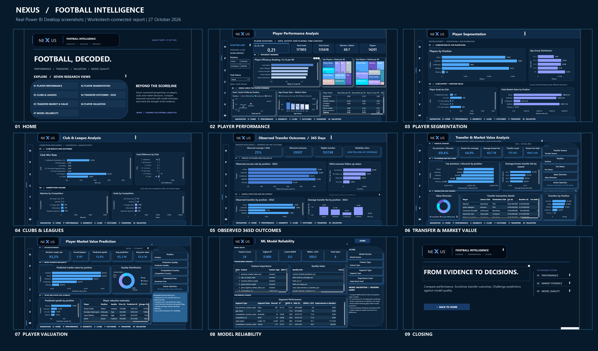
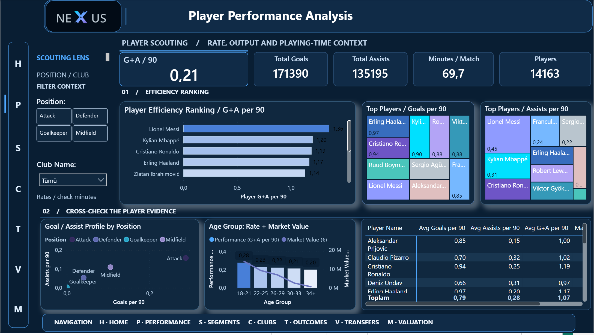
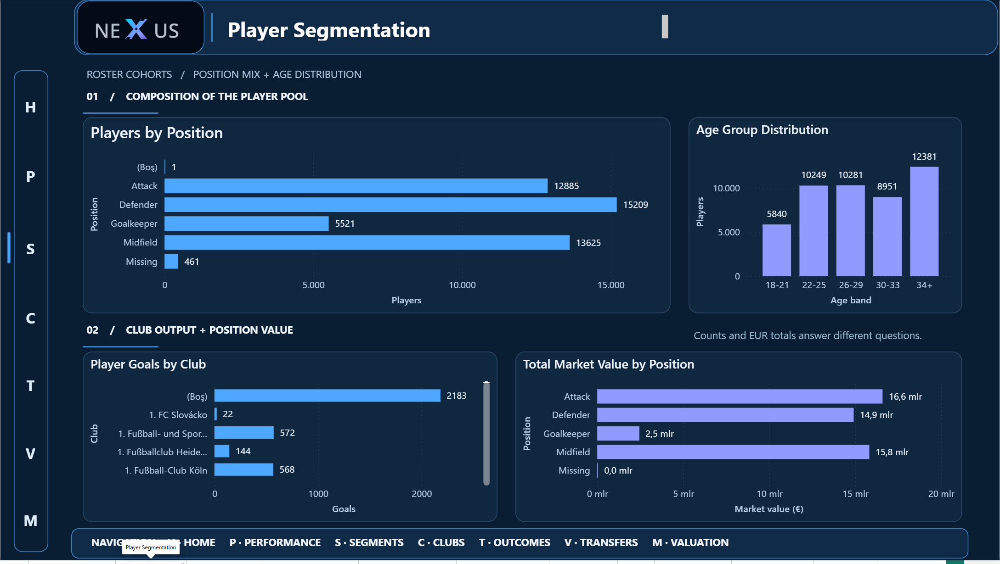
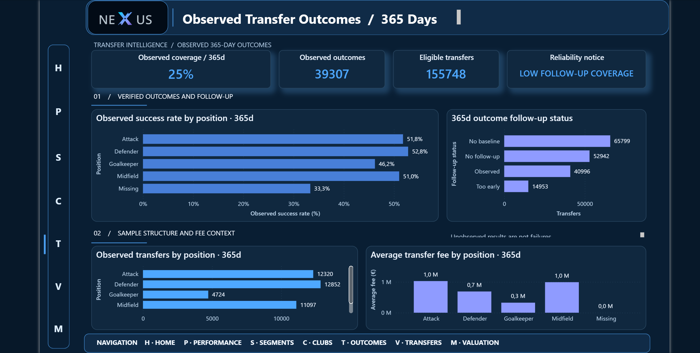
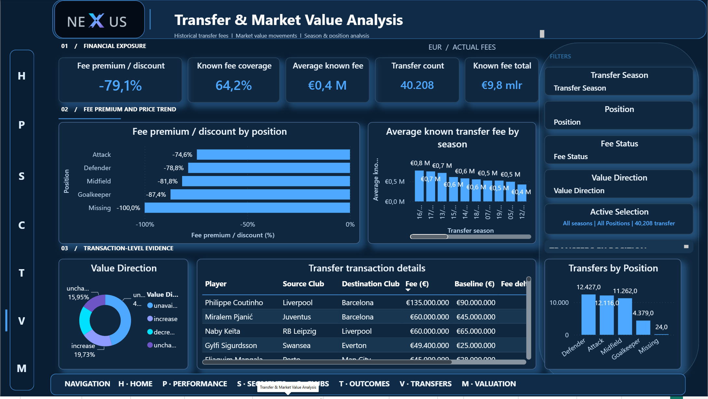
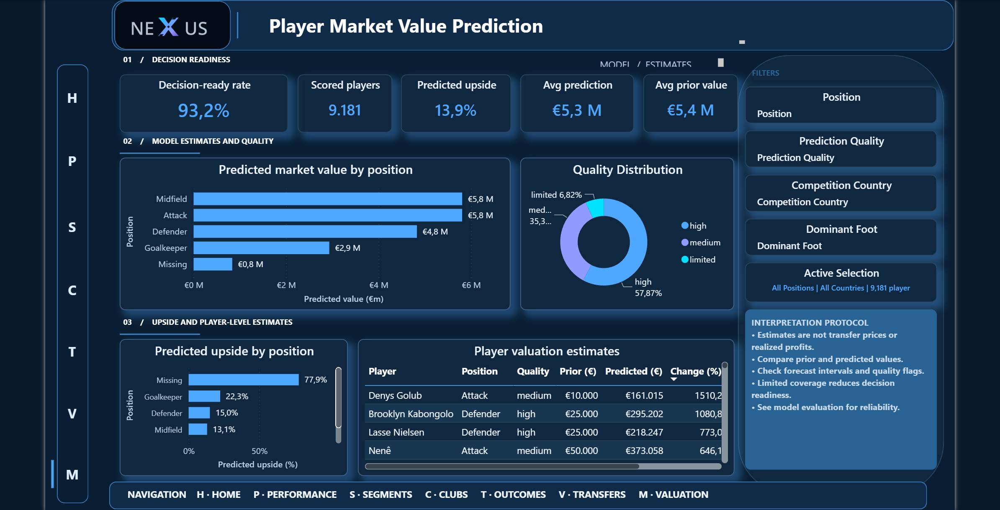
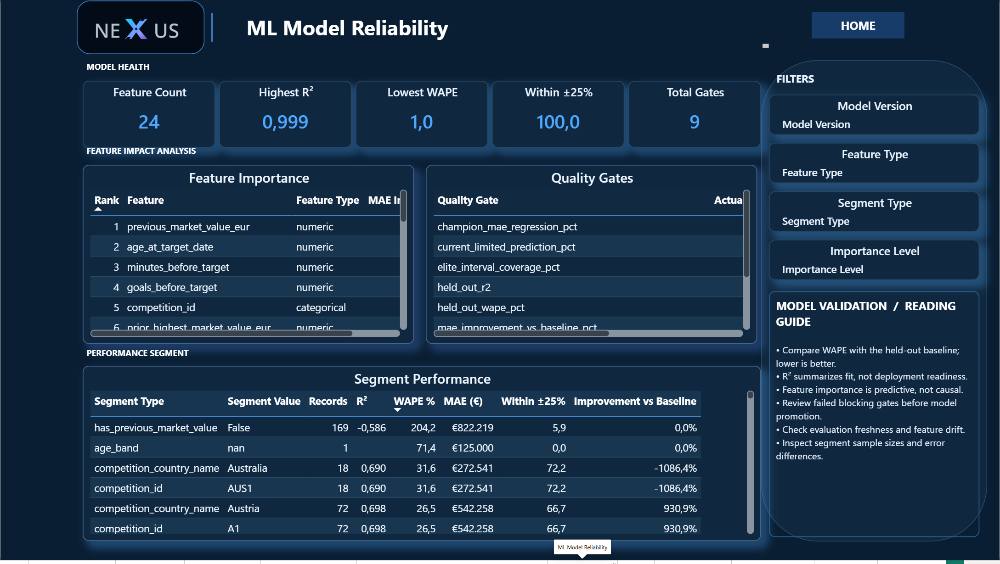
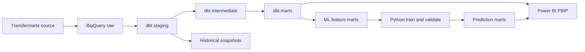

# NEXUS Football Intelligence

**Football Player Performance Analysis | BigQuery · dbt · Python/ML · Power BI**

[](docs/ARCHITECTURE.md)
[](dbt_project.yml)
[](powerbi/workspace/FootballPlayerAnalysis/FootballPlayerAnalysis.pbip)
[](LICENSE)

End-to-end football intelligence, from Transfermarkt data and governed BigQuery/dbt models to leakage-aware market-value modeling, observed transfer outcomes and **13 editable Power BI report pages**.

**[Current project status](docs/PROJECT_STATUS.md)** · **[Documentation index](docs/README.md)** · **[Governed KPI dictionary](docs/KPI_DICTIONARY.md)**

**[Open production Power BI project](powerbi/workspace/FootballPlayerAnalysis/FootballPlayerAnalysis.pbip)** · **[View all genuine screenshots](docs/assets/screenshots/README.md)** · **[Architecture](docs/ARCHITECTURE.md)** · **[Model methodology](docs/PLAYER_MARKET_VALUE_ML.md)**



> **Current verification — 19 October 2026:** Independent Windows SentinelX checkout: **249/249 Python tests PASS** after offline documentation checks were extended (**246/246 after the earlier cleanup; 243/243 on the initial baseline**), **47/47 ML tests PASS**, offline dbt parse **46 models / 243 declared dbt tests** PASS. The owner previously accepted the Power BI workstream; 13 historical screenshots remain available, but **authenticated BigQuery freshness, real-data model backtesting and final CircleCI are not verified**. The decision remains **REVIEW PENDING**. See [dated executed evidence](docs/SENTINELX_OFFLINE_VERIFICATION_20261019.md) and [remaining gates](docs/PROJECT_STATUS.md).

## Project origin — Workintech team project

**This is a collaborative training project developed with a team during the Workintech Data Pro program, not a solo-authored portfolio project.** The repo's foundation also incorporates earlier collaborative/upstream dbt work. The current fork documents subsequent extensions in its analytics models, semantic layer, Power BI reporting, validation, and player-market-value research. Treat those as **repository-level outputs**, not an assertion that one person created every component.

Attribution and historical model provenance are recorded in the [reviewer brief](docs/hiring-summary.md), upstream Git history, and contributor commits. The 17 October Power BI screenshots are historical captures; the owner subsequently accepted the existing visual workstream, but an authenticated post-refresh metric audit remains outstanding.

## What the project delivers

| Component | Scope |
|---|---|
| Data engineering | Transfermarkt raw data on BigQuery, dbt staging and intermediate models, analytics marts, snapshots, data quality |
| Football analytics | Player performance, positional cohorts, club/league comparisons, transfer-value and 365-day observed outcomes |
| Machine learning | Player market-value estimation with time-aware features and a previous-value persistence benchmark |
| Interactive BI | 9 presentation pages, 2 hidden drillthrough detail pages, 2 tooltip pages in editable PBIP/PBIR format |
| Presentation | NEXUS midnight/navy design, cyan and lavender accents; verifiable real Desktop PNGs |

The repository extends earlier collaborative work; attribution and project contributions are documented in the [reviewer summary](docs/hiring-summary.md). The football dataset remains subject to the [source data license and terms](https://www.kaggle.com/datasets/davidcariboo/player-scores).

## Power BI dashboard screenshots

The visuals below are cropped **actual Windows Power BI Desktop captures**; they are not regenerated charts or synthetic offline-demo images.

| Player performance | Player segmentation |
|---|---|
| [](docs/assets/screenshots/production/02_player_performance.png) | [](docs/assets/screenshots/production/03_player_segmentation.png) |
| **Per-90 ranking, goals/assists and player comparison** | **Position, age and market-value cohorts** |

| Observed transfer outcomes (365 days) | Transfer and market value |
|---|---|
| [](docs/assets/screenshots/production/05_transfer_success.png) | [](docs/assets/screenshots/production/06_transfer_market.png) |
| **Eligible outcomes, follow-up coverage and observed rates** | **Fees, premiums, transfers and valuation distributions** |

| Player market-value prediction | ML model reliability |
|---|---|
| [](docs/assets/screenshots/production/07_market_value_prediction.png) | [](docs/assets/screenshots/production/08_ml_reliability.png) |
| **Published valuation estimates and quality segmentation** | **Feature diagnostics, segment metrics and model-quality gates** |

Browse [the nine-page gallery and all full-resolution screenshots](docs/assets/screenshots/README.md), including Home, Club & League, and Closing. Two unselected-player detail screens and two hidden tooltips are preserved **only as technical evidence** pending further interaction tests.

### Source editions

| Edition | Editable report | Usage |
|---|---|---|
| Production-connected | [`powerbi/workspace/FootballPlayerAnalysis/FootballPlayerAnalysis.pbip`](powerbi/workspace/FootballPlayerAnalysis/FootballPlayerAnalysis.pbip) | Canonical BigQuery model; authorization needed for new refresh |
| Offline regression demo | [`powerbi/offline-demo/FootballPlayerAnalysis/FootballPlayerAnalysis.pbip`](powerbi/offline-demo/FootballPlayerAnalysis/FootballPlayerAnalysis.pbip) | Explicitly **synthetic data**, never evidence of actual player outcomes |

The repository publishes PBIP/PBIR source, **not** a publicly hosted live Power BI Service report. Observed 365-day transfer success is **not** an ML prediction; coverage, cohort definitions and horizon are material to interpretation.

## Architecture



The historically documented model inventory included 12 staging views, 7 intermediate views, 25 marts and 2 ML tables. Counts refer to a **prior documented warehouse validation**, not a new October refresh. See the [model catalog, lineage and source contracts](docs/ARCHITECTURE.md).

## Market-value modeling and limitations

A previous-value persistence baseline is essential: predicting the next valuation **level** can achieve a high R² even when the change is difficult to predict. The project evaluates chronology-aware features and quality cohorts rather than claiming that fit on levels proves market forecasting ability.

| Historical v5 evaluation | Ensemble | Previous-value baseline |
|---|---:|---:|
| MAE (EUR) | 781,409 | 867,156 |
| RMSE (EUR) | 2,039,156 | 2,248,309 |
| R² (value level) | 0.9756 | 0.9704 |
| WAPE | 12.51% | 13.88% |

*Historical evaluation reproduced from the project's documentation, not a fresh test performed during the October 2026 screenshot capture.* See [methodology and temporal leakage controls](docs/PLAYER_MARKET_VALUE_ML.md).

Related research: [Kaggle market-value baseline notebook](https://www.kaggle.com/code/senanuretin/your-market-value-r2-is-mostly-last-year-s-price) and [Hugging Face model card](https://huggingface.co/senanurcetin/transfermarkt-value-change-lgbm).

## Reproduction

Requires Python 3.10+, an authorized Google Cloud BigQuery environment, the source datasets, and compatible Power BI Desktop for PBIP editing.

```bash
python -m pip install -r requirements.txt
# Configure profiles.yml.example under ~/.dbt/profiles.yml (do not commit secrets)
dbt debug
dbt source freshness --selector raw_sources
dbt build
dbt test
```

To validate the market-value pipeline, with data credentials and training dependencies set up:

```bash
python -m pip install -r requirements-ml.txt
# Run with an authorized Google Cloud project and suitable ADC credentials.
# The following may create local artifacts and query billed BigQuery data.
python scripts/train_player_market_value.py --project-id YOUR_GCP_PROJECT
python scripts/verify_ml_artifact.py
# Run only after governed ML tables have been explicitly published.
python scripts/verify_published_ml_outputs.py --project-id YOUR_GCP_PROJECT
```

Offline source checks and screenshot artifact integrity:

```bash
python scripts/check_powerbi_project.py
python scripts/check_declared_documentation.py  # YAML declarations only, not physical BigQuery columns
python scripts/check_powerbi_offline_demo.py
python scripts/audit_powerbi_visuals.py
python scripts/audit_powerbi_layout.py
python scripts/verify_dashboard_screenshots.py
python -m unittest discover -s tests
```

**Scope:** Static tests validate source and stored screenshots; they do not certify current BigQuery data or Power BI interactions. The **18–19 October 2026 documentation audit** removed obsolete product/portfolio/CI-recovery handoffs, created [KPI contracts](docs/KPI_DICTIONARY.md), and reconciled actual CI workflow triggers in the [runbook](docs/RUNBOOK.md). Historical screenshot values were checked but the three-row 365d discrepancy and full runtime acceptance remain open. No productization or public deployment is planned. See the [runbook](docs/RUNBOOK.md) and [visual QA requirements](docs/POWER_BI_VISUAL_QA.md).

## Repository structure

```text
.
├── .circleci/                # CI configuration
├── .github/                  # Repository workflows and collaboration
├── analyses/                 # Analytical SQL
├── docs/
│   ├── assets/screenshots/   # Genuine Desktop captures, curated gallery and SHA-256 evidence
│   ├── ARCHITECTURE.md
│   ├── BI_DESIGN_SYSTEM.md
│   ├── PLAYER_MARKET_VALUE_ML.md
│   └── RUNBOOK.md
├── macros/                   # dbt macros
├── models/                   # Staging, intermediate, mart and ML models
├── powerbi/
│   ├── workspace/            # BigQuery-backed PBIP
│   └── offline-demo/         # Synthetic regression fixture
├── scripts/                  # ML training, preflight, asset verification
├── seeds/                    # Reference seeds
├── snapshots/                # Historical dimension snapshots
├── tests/                    # dbt and Python quality tests
├── dbt_project.yml
└── profiles.yml.example
```

Diagnostic Power BI caches and temporary local scripts are excluded from source control. Registered report images under `powerbi/**/StaticResources/` remain because deleting them can break the native PBIR report.

## Release acceptance status

- [x] Editable NEXUS production PBIP and separate synthetic test edition retained.
- [x] 13 genuine report-area PNG captures, including nine fully rendered presentation views.
- [x] Nine NEXUS-framed portfolio images and a consolidated gallery.
- [x] Real-capture provenance, hashes and automated screenshot integrity checks.
- [x] Owner accepted existing Power BI designs and screenshots; refreshed-data parity remains pending.
- [ ] Drillthrough pages validated with selected players, error-free visuals and navigation.
- [ ] Current production BigQuery freshness, warehouse-to-model reconciliation and refresh outcome verified.
- [ ] Release sign-off, if publication is required.

**Quality rule:** Do not turn successful source tests or historical screenshots into unsupported claims of a current live deployment.

## Documentation and contribution

[Documentation index](docs/README.md) · [Screenshot evidence](docs/assets/screenshots/README.md) · [Architecture](docs/ARCHITECTURE.md) · [Data quality](docs/DATA_QUALITY.md) · [ML model](docs/PLAYER_MARKET_VALUE_ML.md) · [Power BI modeling](docs/POWER_BI_MODELING.md) · [BI design](docs/BI_DESIGN_SYSTEM.md) · [Operations](docs/RUNBOOK.md) · [Reviewer summary and attribution](docs/hiring-summary.md) · [Contributing](CONTRIBUTING.md) · [MIT license](LICENSE)
